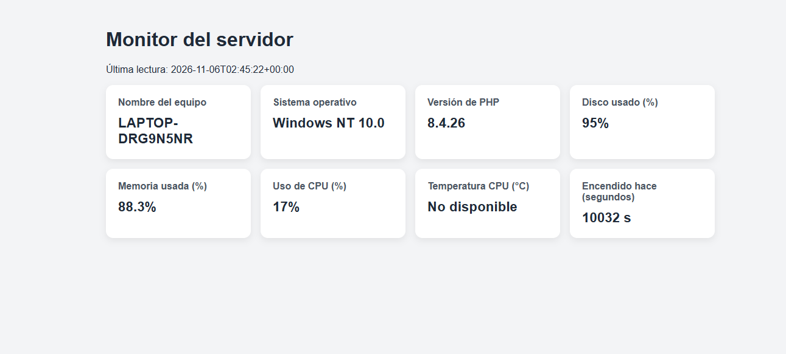
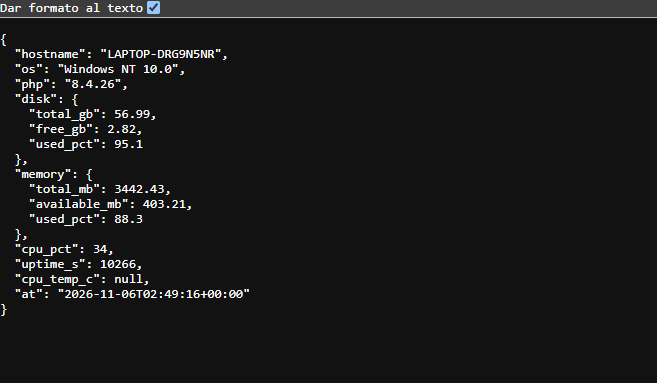

# Monitor de Servidor con Laravel

**Programación IV — UTN FRRe**

**Autor:** José Alexander Benítez

**Sistema operativo:** Windows NT 10.0

## Cómo levantar el proyecto

Requiere PHP 8.4, Composer y las extensiones `pdo_sqlite` y `sqlite3` habilitadas.

```powershell
cd C:\xampp\htdocs\monitor-servidor
composer install
php artisan migrate
php artisan serve
```

Abrir `http://127.0.0.1:8000/servidor`. La página actualiza las métricas cada cinco segundos.

## Endpoints

- `GET /servidor`: página del monitor.
- `GET /api/metrics`: métricas en JSON, limitado a 60 pedidos por minuto.

## Capturas





## Preguntas

1. **¿Por qué la temperatura suele aparecer como "No disponible" en Windows?**

   Puede requerir permisos de administrador y que la placa informe la temperatura mediante ACPI/WMI. Se puede comparar ejecutando la aplicación como administrador.

2. **¿Por qué el script de PowerShell nunca debe incluir datos del usuario?**

   Para evitar inyección de comandos: datos manipulados podrían ejecutarse como parte del script.

3. **¿Qué riesgo tiene dejar `/api/metrics` sin autenticación en un servidor real?**

   Expone información de infraestructura útil para reconocimiento de ataques y permite abuso o DoS, ya que cada pedido inicia PowerShell.

4. **Con polling cada 5 s y 50 personas, ¿cuántos pedidos por minuto?**

   `50 × 12 = 600` pedidos por minuto.

5. **Si una app solo necesita la temperatura, ¿qué recibe de más en `/api/metrics`?**

   `hostname`, `os`, `php`, `disk`, `memory`, `cpu_pct`, `uptime_s` y `at`: es *over-fetching*. GraphQL permite solicitar solo los campos necesarios.
